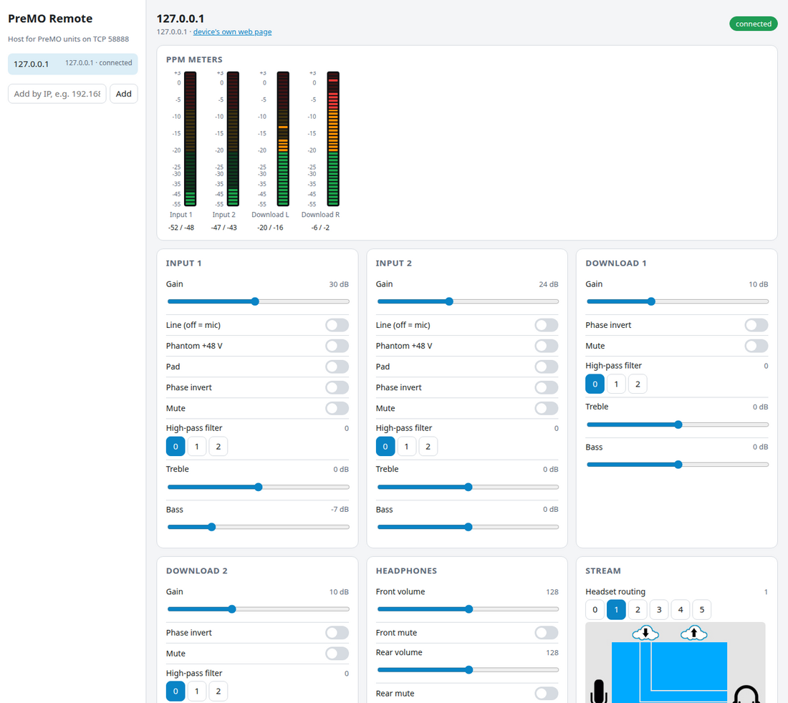

# premote: PreMO host application (Rust)

`premote` is a single program that replaces the legacy Windows tools for the PreMO
(found in `../preMO remote-20261119T130500Z-1-001/`):

| Legacy tool | What it did | Replaced by |
|---|---|---|
| `PreMo.exe` 1.22.0 (Windows Forms, .NET 4.5.2) | Found units with Bonjour, connected on TCP 58888, showed every control, PPM meters, loaded presets | `premote serve` + the web page |
| `TCPRemote.exe` ("PreMoUpdate") | Firmware upload (REBOOT, then 200-byte packets) | `premote update`, or the Firmware card on the page |
| Update form inside PreMo.exe | Same firmware protocol over the open connection | same |
| Bonjour for Windows (`Interop.Bonjour.dll`) | mDNS discovery | built in (`mdns-sd`), nothing to install |

It is a **host application**: it discovers PreMO units, keeps a live connection to each
one, and **hosts an HTML control page for every device** at `http://<host>:8080/device/<ip>`.
It runs on Linux, macOS and Windows.



## Quick start

```sh
cargo build --release
./target/release/premote serve            # discover units, web page on http://localhost:8080/
```

Then open <http://localhost:8080/>. Units announcing `_rtsp._tcp` appear on the left; any
other unit can be added by IP address. Each device page has:

- **PPM meters**: four 40-segment bars (Input 1, Input 2, Download L/R) with peak hold, scaled
  like the original `PPMMeter` control (-55 … +3).
- **Control cards**, one per block: Input 1/2 (gain, mic/line, phantom, pad, phase, mute,
  HPF, treble, bass), Download 1/2, Headphones, Stream (headset/upload routing with the
  original routing diagrams, stream gain, mutes), System (brightness, display mode, mic mute,
  PPM switch), Tone generator (read-only).
- **Presets** 0–9: Read (load into the page), Recall (make active), Store.
- **Firmware update**: choose a `.bin`, optionally skip REBOOT, watch the progress bar.
- **Raw command**: send any block/object/value for experiments.
- **Log**: connection events, unmapped notifications, updater messages.

Every change made on the device's front panel (or by another client) appears on the page
straight away; every change on the page is sent straight away.

## Commands

```text
premote serve [--bind 0.0.0.0:8080] [--device IP]... [--no-discovery] [--port 58888]
premote discover [--secs 4]                  list _rtsp._tcp services on the network
premote set <ip> <key> <value>               e.g. premote set 10.0.0.5 ch1_gain 40
premote preset <ip> read|select|write <0-9>
premote update <ip> <file.bin> [--no-reboot] [--delay-ms 0]
premote simulate [--port 58888]              a fake PreMO for testing
premote controls                             print the object map
```

`RUST_LOG=premote=debug` shows every command sent.

### Trying it without hardware

```sh
premote simulate --port 59999 &
premote serve --device 127.0.0.1 --port 59999 --no-discovery
# open http://localhost:8080/device/127.0.0.1
premote update 127.0.0.1 "../preMO remote-20261119T130500Z-1-001/preMO remote/Premo2,19/APP2.bin" --port 59999
```

The simulator streams moving meter levels, answers every control, keeps 10 presets and runs
the boot-loader side of the firmware protocol. It models what the legacy remote *expected*
from a device. It is not an emulation of the real firmware.

## Documentation

- [docs/PROTOCOL.md](docs/PROTOCOL.md): the wire protocol: OCP.1 command / notification /
  response layouts, every object number, the preset layout, the firmware upload protocol and
  discovery, with the legacy source each fact came from.
- [docs/ARCHITECTURE.md](docs/ARCHITECTURE.md): how the program is built: modules, tasks,
  data flow, web API and WebSocket events.
- [docs/LEGACY-MAP.md](docs/LEGACY-MAP.md): every legacy class and form, and where its
  behaviour lives now (or why it was dropped).
- [docs/VERIFICATION.md](docs/VERIFICATION.md): what has been tested, how, and what still
  needs a real unit.

The source is commented throughout; start with `src/main.rs`.

## Status and caveats

- Everything was reconstructed from the decompiled binaries, and it has been tested only
  against the built-in simulator. **It has not yet been run against a real PreMO.** The parts
  most likely to need adjusting on real hardware are listed in
  [docs/VERIFICATION.md](docs/VERIFICATION.md).
- Discovery lists every `_rtsp._tcp` service, as PreMo.exe did. Other WBS units that stream
  RTSP (for example a 32ME) appear too, but they stay "disconnected" because they don't
  answer on TCP 58888.
- The legacy login screen (`Login.cs`, users in `UserInfo.xml`) was never shown by PreMo.exe
  1.22.0, so it was not carried over. The web server has no authentication: run it on a
  trusted control network, or behind a reverse proxy that adds it.
